<p align="center">
  <picture>
    <source media="(prefers-color-scheme: dark)" srcset="docs/readme/img/wordmark-dark.svg">
    
  </picture>
</p>

<p align="center">
  A remote-job agent for people who live in Brazil.<br>
  <b>English</b> · <a href="README.pt-BR.md">Português (BR)</a>
</p>

---

At least once in their career, every dev has dreamed of working abroad: other countries, other time zones, other cultures. Then you open a job board and reality kicks in. Half the "remote" jobs turn out to be "remote, US only" somewhere in the fine print. The salary is in dollars or euros and you do the math in your head. And you still have to guess whether your résumé is even close.

So I built an agent that does that reading for me. And because my name is Ian, it became **ian.ternational**.

You ask in plain language. It searches two job boards, drops what doesn't accept candidates in Brazil, converts the salary to reais, compares the job with your résumé, and checks each thing it's about to tell you against the job ad before it says it.

<p align="center">
  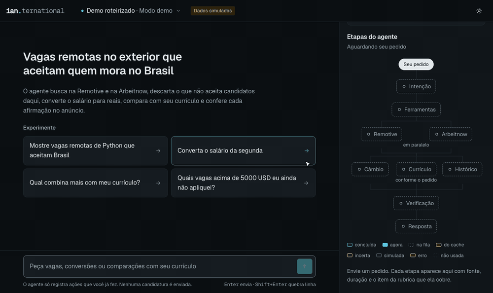
</p>
<p align="center"><sub>
  The question on screen: <i>"Show me remote Python jobs that accept Brazil."</i> The interface is in Portuguese because that's who it's for. The jobs in these recordings are made-up samples.
</sub></p>

<p align="center">
  <a href="https://youtu.be/I91282WyBMc"><picture><source media="(prefers-color-scheme: dark)" srcset="docs/readme/img/card-video-en-dark.svg"></picture></a>
  <a href="https://claude.ai/artifact/HwoGkNo6gDsFqVJn4GHFMk"><picture><source media="(prefers-color-scheme: dark)" srcset="docs/readme/img/card-flow-en-dark.svg"></picture></a>
  <a href="output/pdf/ian_trinta_ai-agents_langchain-agents.pdf"><picture><source media="(prefers-color-scheme: dark)" srcset="docs/readme/img/card-report-en-dark.svg"></picture></a>
</p>

## What you can ask it

### "Does this job actually accept Brazil?"

The agent's first draft said a job was open to Brazil. The ad said "Remote, US only." Before answering, the agent compares every claim with the text of the ad, and when they disagree, the ad wins: the job leaves the list and you can open the receipt.

<p align="center">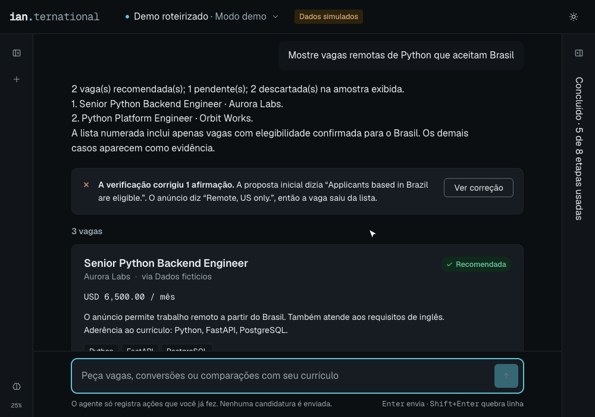</p>

### "Convert the salary of the second one"

It knows which one "the second one" is, reads the salary from the ad, gets the exchange rate, and shows the amount in reais with the rate and date it used.

<p align="center">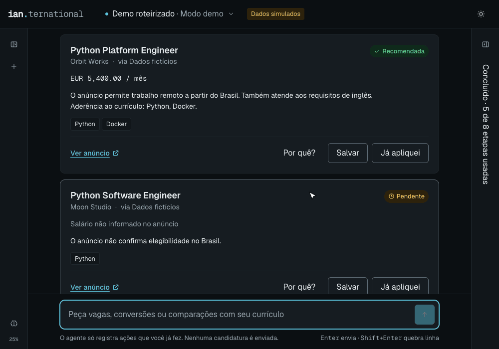</p>

### "Which ones haven't I applied to yet?"

Click **Já apliquei** ("I've applied") on a job and it's marked as applied. Later you can just ask what's left. The agent only keeps track of what you did. It never sends an application for you.

<p align="center">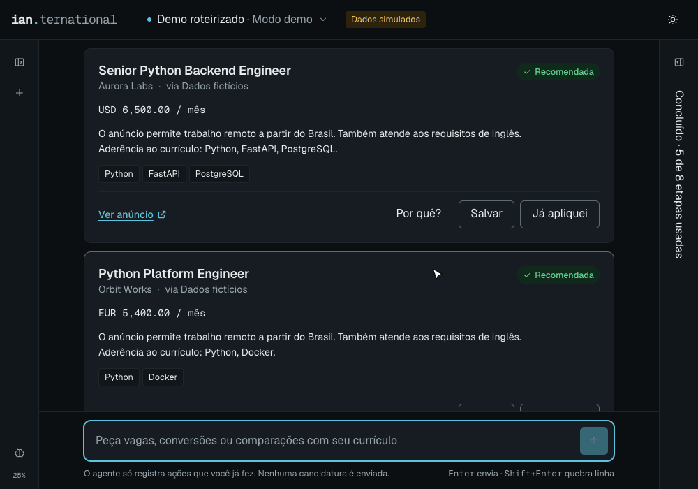</p>

### "Remember that I'd rather avoid Docker"

Tell it a preference once. In a brand-new conversation, the job that asks for Docker is already out, with the reason written next to it.

<p align="center">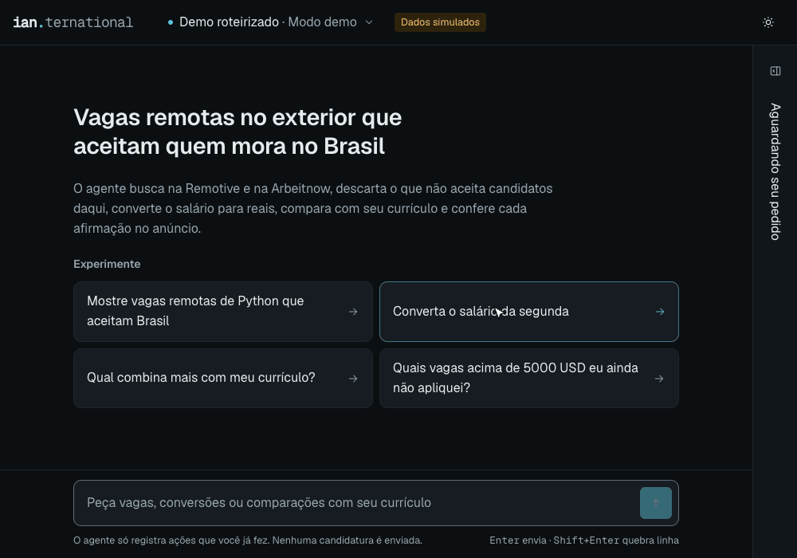</p>

## How it thinks

Every question takes a path. Some steps are the AI deciding, some are plain fixed code (rules don't need creativity), and some are data coming from outside. This is the path of a job search:

<p align="center">
  <picture>
    <source media="(prefers-color-scheme: dark)" srcset="docs/readme/flow/search-en-dark.svg">
    
  </picture>
</p>

Other questions take other paths:

<details>
<summary>Convert a salary</summary>
<p align="center"><picture><source media="(prefers-color-scheme: dark)" srcset="docs/readme/flow/salary-en-dark.svg"></picture></p>
</details>

<details>
<summary>Compare with my résumé</summary>
<p align="center"><picture><source media="(prefers-color-scheme: dark)" srcset="docs/readme/flow/resume-en-dark.svg"></picture></p>
</details>

<details>
<summary>What haven't I applied to?</summary>
<p align="center"><picture><source media="(prefers-color-scheme: dark)" srcset="docs/readme/flow/history-en-dark.svg"></picture></p>
</details>

<details>
<summary>Remember a preference</summary>
<p align="center"><picture><source media="(prefers-color-scheme: dark)" srcset="docs/readme/flow/memory-en-dark.svg"></picture></p>
</details>

Want to click through each step and see what happens inside it? The [interactive version](https://claude.ai/artifact/HwoGkNo6gDsFqVJn4GHFMk) has every step explained (in Portuguese).

## It checks itself

An agent that sounds confident and is wrong is worse than no agent. Two things keep this one honest:

- **Before answering**, every claim is compared with the job ad by a small model that runs on your own machine. A contradiction removes the job from the list.
- **After building it**, I ran it against test cases with known right answers: 12 out of 12 on the scripted scenarios, and 6 out of 6 with the real model, where it had to pick the right route and the right tools. The [evaluation is public on LangSmith](https://smith.langchain.com/public/b64697c5-7b1f-4b57-8614-0e56daf802d9/d).

The interface doesn't hide any of it. Every answer comes with the steps the agent took, where each piece of data came from, and how long it took.

<p align="center">
  <picture>
    <source media="(prefers-color-scheme: dark)" srcset="docs/readme/img/app-dark.png">
    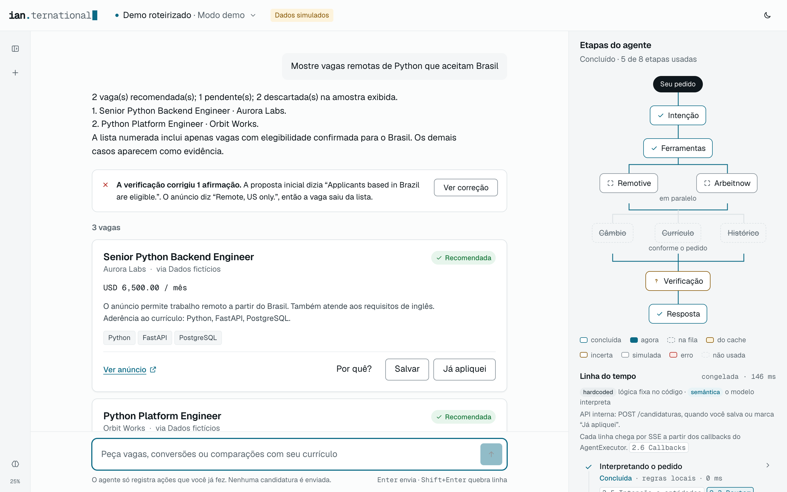
  </picture>
</p>

## Under the hood

| Piece | What it does |
|---|---|
| **LangChain** | The agent itself: one agent, five tools, short and long-term memory |
| **OpenAI** | The model that understands the request and writes the answer |
| **Remotive, Arbeitnow, AwesomeAPI** | Where the jobs and the exchange rates come from |
| **FAISS + SQLite** | Finding the right parts of the résumé, and remembering jobs, applications and preferences |
| **A local NLI model** | The fact-check, running on CPU with no API call |
| **FastAPI + Vue 3** | The server and the interface, with answers streaming in as they're written |
| **LangSmith** | Tracing every step and running the evaluation |

The full story, with every design decision, is in the [technical report](output/pdf/ian_trinta_ai-agents_langchain-agents.pdf) (PDF, in Portuguese).

## Run it yourself

No API key needed. By default it runs in demo mode, with sample jobs and a sample résumé.

```bash
uv venv --python 3.12 && uv pip sync requirements.txt
```

```bash
.venv/bin/python -m scripts.setup_assets
```

```bash
.venv/bin/uvicorn src.api:app
```

Then open [localhost:8000](http://127.0.0.1:8000). To use real jobs and the real model, and for everything else (CLI, notebooks, tests, evaluation), see the [setup guide](docs/SETUP.md) (in Portuguese).

---

<sub>
Built as a college project at Infnet. The sample jobs and the résumé in the demo are fictional. In the code you'll still find the project's working name, "Radar Remoto". I used OpenAI Codex to implement the agent, Claude Design to prototype the interface, and Claude Code for the Vue interface and the routes that serve it. The GIFs and diagrams on this page are generated by the scripts in <a href="scripts/readme">scripts/readme</a>.
</sub>
