<p align="center">
  <picture>
    <source media="(prefers-color-scheme: dark)" srcset="docs/readme/img/wordmark-dark.svg">
    
  </picture>
</p>

<p align="center">
  Um agente de vagas remotas para quem mora no Brasil.<br>
  <a href="README.md">English</a> · <b>Português (BR)</b>
</p>

---

Pelo menos uma vez na carreira, todo dev já sonhou em trabalhar para fora: outros países, outros fusos, outras culturas. Aí você abre um site de vagas e a realidade aparece. Metade das vagas "remotas" é "remote, US only" em alguma linha miúda. O salário vem em dólar ou euro e a conta fica de cabeça. E ainda sobra adivinhar se o seu currículo chega perto.

Então eu fiz um agente que lê tudo isso por mim. E como meu nome é Ian, ele virou **ian.ternational**.

Você pergunta do seu jeito. Ele busca em dois sites de vagas, tira o que não aceita candidato no Brasil, converte o salário para reais, compara a vaga com o seu currículo e confere no anúncio cada coisa que vai te dizer, antes de dizer.

<p align="center">
  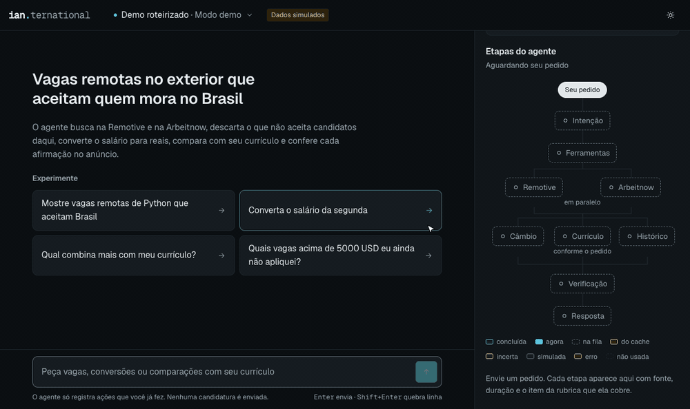
</p>
<p align="center"><sub>
  As vagas destas gravações são exemplos fictícios do modo demo.
</sub></p>

<p align="center">
  <a href="https://youtu.be/I91282WyBMc"><picture><source media="(prefers-color-scheme: dark)" srcset="docs/readme/img/card-video-pt-dark.svg"></picture></a>
  <a href="https://claude.ai/artifact/HwoGkNo6gDsFqVJn4GHFMk"><picture><source media="(prefers-color-scheme: dark)" srcset="docs/readme/img/card-flow-pt-dark.svg"></picture></a>
  <a href="output/pdf/ian_trinta_ai-agents_langchain-agents.pdf"><picture><source media="(prefers-color-scheme: dark)" srcset="docs/readme/img/card-report-pt-dark.svg"></picture></a>
</p>

## O que dá para perguntar

### "Essa vaga aceita mesmo o Brasil?"

O primeiro rascunho do agente dizia que uma vaga aceitava candidatos no Brasil. O anúncio dizia "Remote, US only". Antes de responder, o agente compara cada afirmação com o texto do anúncio, e quando os dois discordam quem ganha é o anúncio: a vaga sai da lista e você pode abrir o comprovante.

<p align="center">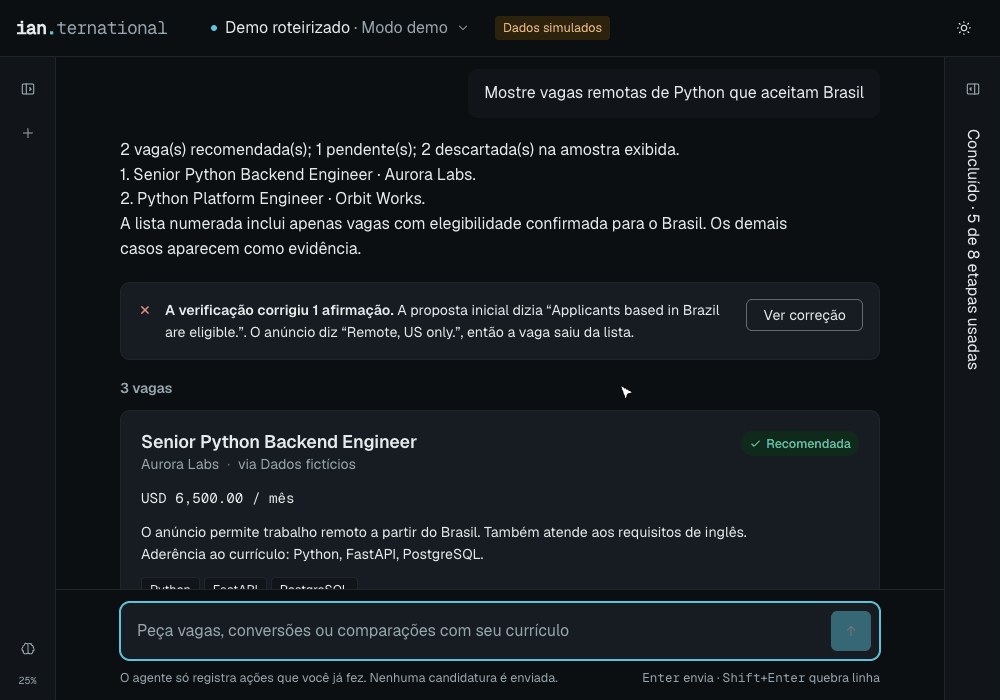</p>

### "Converta o salário da segunda"

Ele sabe qual é "a segunda", lê o salário no anúncio, busca a cotação e mostra o valor em reais com a taxa e a data que usou.

<p align="center">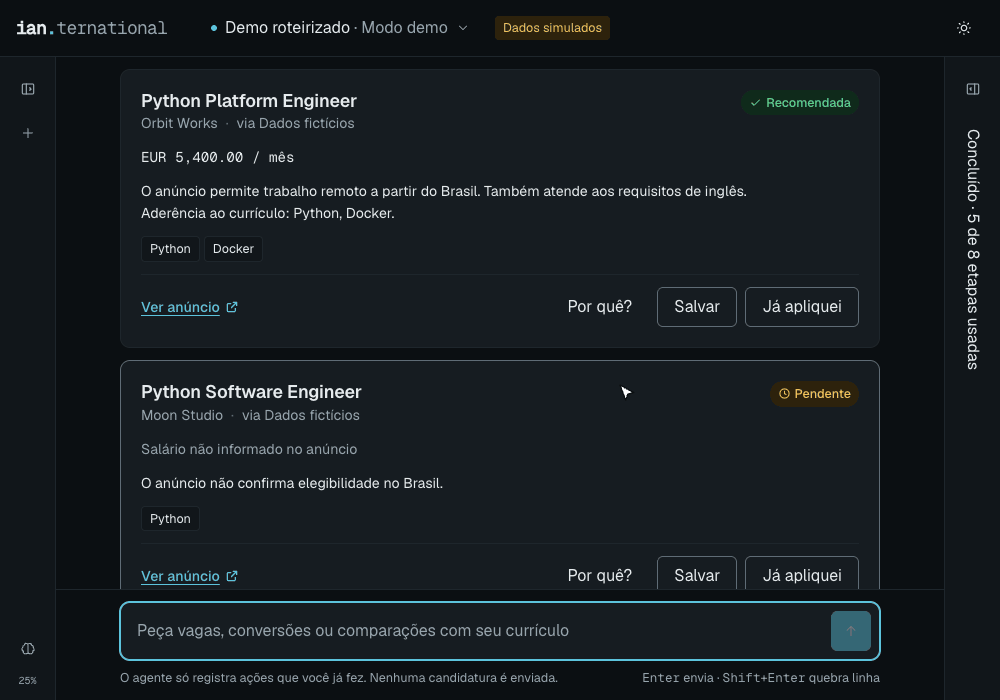</p>

### "Quais eu ainda não apliquei?"

Clique em **Já apliquei** e a vaga fica marcada como aplicada. Depois é só perguntar o que falta. O agente só registra o que você fez. Ele nunca envia candidatura por você.

<p align="center">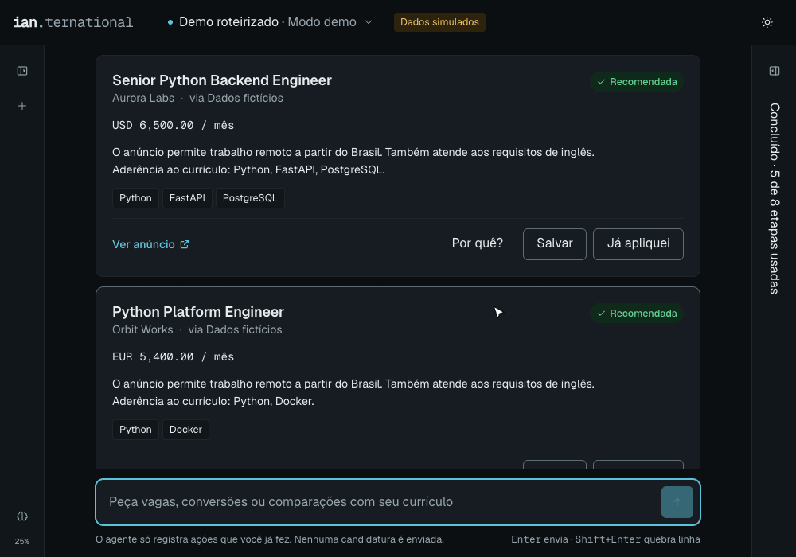</p>

### "Lembre que prefiro evitar vagas com Docker"

Conte uma preferência uma vez. Numa conversa nova, a vaga que pede Docker já fica de fora, com o motivo escrito ao lado.

<p align="center">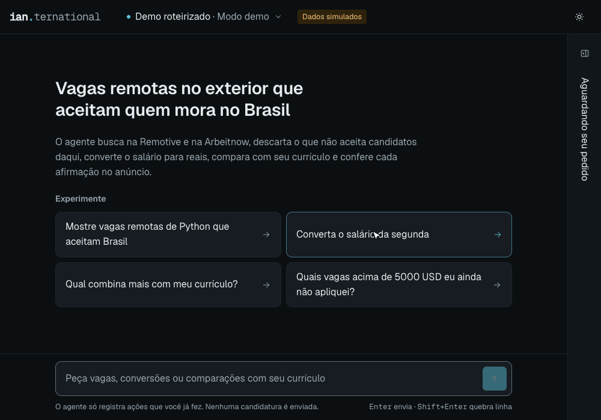</p>

## Como ele pensa

Toda pergunta percorre um caminho. Em algumas etapas é a IA que decide, em outras é código fixo (regra não precisa de criatividade), e em outras são dados que vêm de fora. Este é o caminho de uma busca de vagas:

<p align="center">
  <picture>
    <source media="(prefers-color-scheme: dark)" srcset="docs/readme/flow/search-pt-dark.svg">
    
  </picture>
</p>

Outras perguntas fazem outros caminhos:

<details>
<summary>Converter um salário</summary>
<p align="center"><picture><source media="(prefers-color-scheme: dark)" srcset="docs/readme/flow/salary-pt-dark.svg"></picture></p>
</details>

<details>
<summary>Comparar com o meu currículo</summary>
<p align="center"><picture><source media="(prefers-color-scheme: dark)" srcset="docs/readme/flow/resume-pt-dark.svg"></picture></p>
</details>

<details>
<summary>O que eu ainda não apliquei?</summary>
<p align="center"><picture><source media="(prefers-color-scheme: dark)" srcset="docs/readme/flow/history-pt-dark.svg"></picture></p>
</details>

<details>
<summary>Lembrar uma preferência</summary>
<p align="center"><picture><source media="(prefers-color-scheme: dark)" srcset="docs/readme/flow/memory-pt-dark.svg"></picture></p>
</details>

Quer clicar em cada etapa e ver o que acontece dentro dela? A [versão interativa](https://claude.ai/artifact/HwoGkNo6gDsFqVJn4GHFMk) explica todas.

## Ele se confere

Um agente que fala com confiança e erra é pior do que não ter agente. Duas coisas mantêm este honesto:

- **Antes de responder**, cada afirmação é comparada com o anúncio por um modelo pequeno que roda na sua própria máquina. Contradição tira a vaga da lista.
- **Depois de pronto**, rodei o agente contra casos de teste com resposta certa conhecida: 12 de 12 nos cenários roteirizados e 6 de 6 com o modelo real, em que ele precisava escolher o caminho e as ferramentas certas. A [avaliação está pública no LangSmith](https://smith.langchain.com/public/b64697c5-7b1f-4b57-8614-0e56daf802d9/d).

A interface não esconde nada disso. Toda resposta vem com as etapas que o agente seguiu, de onde veio cada dado e quanto tempo levou.

<p align="center">
  <picture>
    <source media="(prefers-color-scheme: dark)" srcset="docs/readme/img/app-dark.png">
    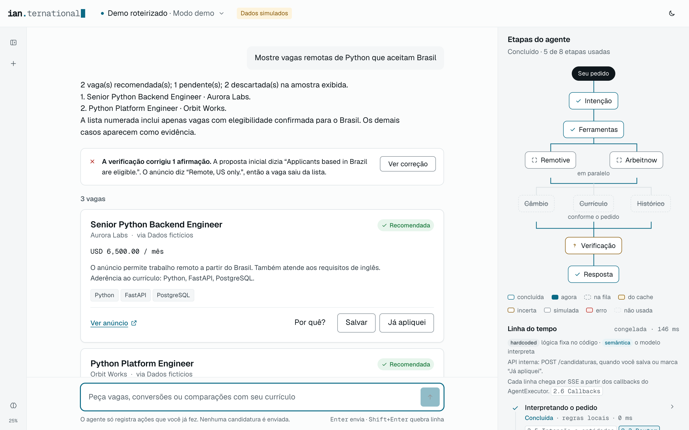
  </picture>
</p>

## Por baixo do capô

| Peça | O que faz |
|---|---|
| **LangChain** | O agente em si: um agente, cinco ferramentas, memória de curto e de longo prazo |
| **OpenAI** | O modelo que entende o pedido e escreve a resposta |
| **Remotive, Arbeitnow, AwesomeAPI** | De onde vêm as vagas e a cotação |
| **FAISS + SQLite** | Achar os trechos certos do currículo e lembrar de vagas, candidaturas e preferências |
| **Um modelo NLI local** | A checagem dos fatos, rodando em CPU, sem chamada de API |
| **FastAPI + Vue 3** | O servidor e a interface, com a resposta chegando enquanto é escrita |
| **LangSmith** | O registro de cada passo e a avaliação |

A história completa, com cada decisão de projeto, está no [relatório técnico](output/pdf/ian_trinta_ai-agents_langchain-agents.pdf) (PDF).

## Rode você mesmo

Não precisa de chave de API. Por padrão ele roda em modo demo, com vagas e currículo de exemplo.

```bash
uv venv --python 3.12 && uv pip sync requirements.txt
```

```bash
.venv/bin/python -m scripts.setup_assets
```

```bash
.venv/bin/uvicorn src.api:app
```

Depois abra [localhost:8000](http://127.0.0.1:8000). Para usar vagas reais e o modelo real, e para todo o resto (CLI, notebooks, testes, avaliação), veja o [guia de instalação](docs/SETUP.md).

---

<sub>
Feito como trabalho de faculdade na Infnet. As vagas e o currículo da demo são fictícios. No código você ainda encontra o nome de trabalho do projeto, "Radar Remoto". Usei o OpenAI Codex na implementação do agente, o Claude Design no protótipo da interface e o Claude Code na interface em Vue e nas rotas que a servem. Os GIFs e diagramas desta página são gerados pelos scripts em <a href="scripts/readme">scripts/readme</a>.
</sub>
